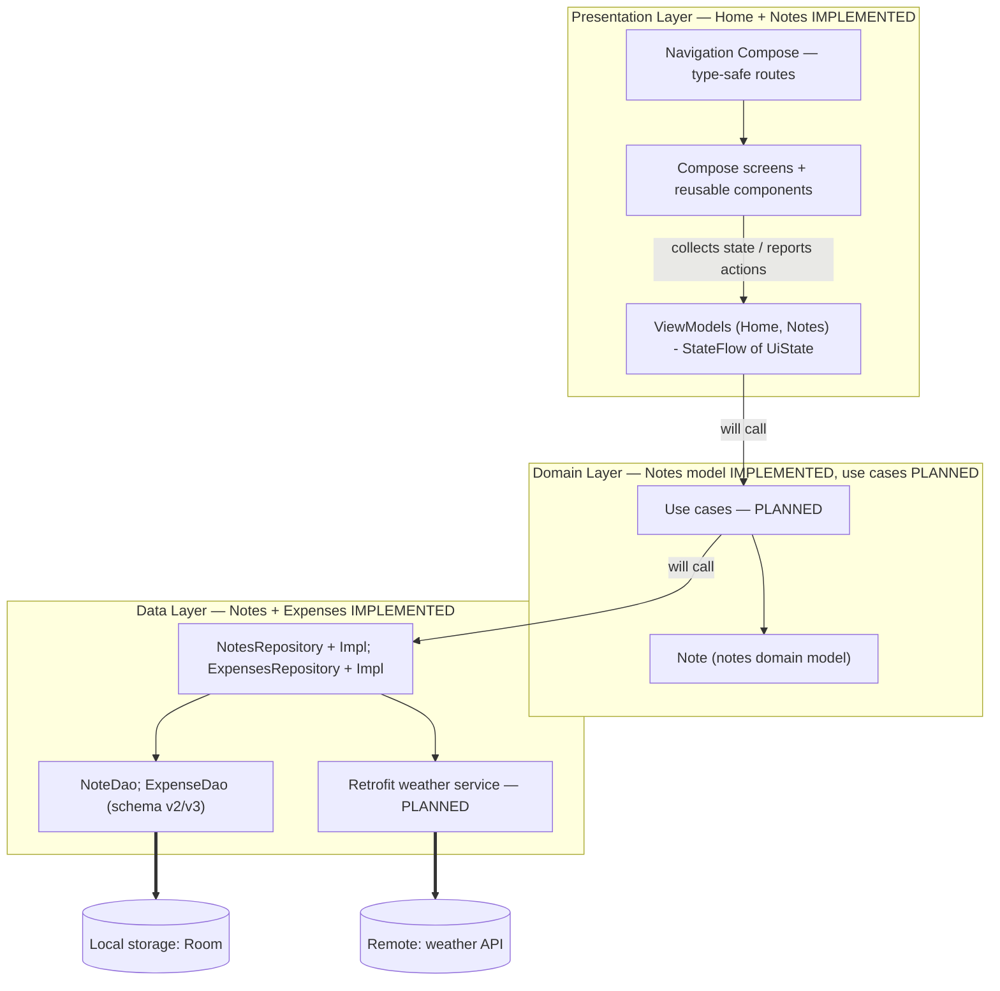

# SYSTEM_DESIGN.md — Campus Helper System Design

> Companion documents: `AGENTS.md` (agent rules), `ARCHITECTURE.md` (technical
> code structure), `PROJECT_CONTEXT.md` (implementation status),
> `UI_UX_GUIDELINES.md` (design system). Status labels used in this document:
> **IMPLEMENTED**, **PLANNED**, **NOT AVAILABLE**.

## 1. Application overview

Campus Helper is a native Android application for university students. It
consolidates the scattered tools a student currently juggles (paper
timetables, separate notes apps, mental arithmetic for expenses, reminders in
chat groups) into one dark, minimalist, offline-first productivity app:

- **Uncertainty → clarity:** the dashboard shows what matters *today* —
  classes, deadlines, weather — in one glance.
- **Notes:** quick capture of lecture notes and to-dos.
- **Expenses:** categorization and monthly totals so money leaks become visible.
- **Calendar:** quizzes, assignment deadlines, and academic activities with
  reminders.
- **Schedule:** the weekly class timetable including course and room info.

Design identity: modern minimalist, dark theme, restrained green accent,
Material 3. Full rules in `UI_UX_GUIDELINES.md`.

## 2. Core modules

| Module | Purpose | Status |
|---|---|---|
| **Home** | Student dashboard: greeting header, real current date, quick access to the other four destinations, today's schedule, upcoming events, Cebu weather card, productivity overview | **IMPLEMENTED** (honest empty states; no data sources yet) |
| **Notes** | Create / edit / delete / view saved notes | **IMPLEMENTED** (Phase 3.1 storage, Phase 3.2 ViewModel, Phase 3.3 list screen, Phase 3.4 editor create/edit with unsaved-changes guard; deletion still PLANNED) |
| **Expenses** | Record and review spending, monthly totals, category breakdown | **DATA LAYER IMPLEMENTED (Phase 4.1)** (`ExpenseEntity` schema v3 + `ExpenseDao` + `ExpensesRepository` + domain `Expense`/`ExpenseCategory`, migration 2→3 verified by `Migration_2_3_Test`); ViewModel/UI still PLANNED |
| **Calendar** | Monthly view of quizzes, deadlines, academic activities, reminders | **PLANNED** (placeholder screen) |
| **Schedule** | Weekly class timetable: course, room, start/end times | **PLANNED** (placeholder screen) |
| **Weather (Cebu)** | Live local weather conditions/forecast on the Home dashboard | **NOT AVAILABLE** (no API integrated; the section explicitly says "Not available yet"; no network code exists) |

"PLANNED module" means: the navigation destination, placeholder screen, and
the architecture hooks exist; the feature logic (screens with real content,
data storage, use cases) does not exist yet.

## 3. High-level system flow

Target architecture (MVVM + lightweight Clean Architecture, single module):

### How data moves (unidirectional, top-down outward)

1. **Rendering:** a Compose screen collects a `StateFlow<HomeUiState>`-style
   snapshot from its ViewModel via `collectAsStateWithLifecycle()` and renders
   it. The screen implements no business decisions.
2. **User events:** taps flow upward through callbacks
   (`onOpenNotes`, `onAction(...)` patterns), never sideways into data classes.
3. **Business logic (future):** a ViewModel delegates to a use case; the use
   case orchestrates one business operation against repositories.
4. **Data access:** repositories own data, whether from Room (local) or a
   Retrofit service (remote), and expose either suspending calls or
   `StateFlow`/`Flow` streams of domain models.
5. **Caching rule:** the local Room database is the app's source of truth
   once a module stores data. A future weather service answers "right now"
   reads against the network and never pretends to be a database.

**Current reality (honest):** the Home dashboard renders ViewModel state
directly, and there are no use cases. The Notes feature is now fully
rendered end to end: list screen (Phase 3.3) with debounced search and
loading/error/empty/no-results/success states, plus an editor (Phase 3.4)
for create and edit with an unsaved-changes guard. What is still missing is
deletion and any other data features; weather remains entirely unimplemented.

## 4. Data strategy

- **Persistence:** Room 2.8.5, single `AppDatabase`
  (`core/database/AppDatabase.kt`), KSP annotation processing (no kapt).
  Database file: `campus-helper.db` (app-local storage). Schema version 2
  with `exportSchema = true` — every version's JSON is exported to
  `app/schemas/` and committed. Migrations are explicit
  (`AppDatabase.MIGRATION_1_2`), registered through `ServiceLocator`'s
  `addMigrations`, and never destructive. Honest limitation: schema v1 was
  never exported, so the 1→2 migration has no automated regression test
  (details in `ARCHITECTURE.md §7`).
- **Entities (`data/entity/`):** describe how data is *stored*. `NoteEntity`
  (IMPLEMENTED, v2) and `ExpenseEntity` (IMPLEMENTED, v3): money stored as
  `amount_minor` (centavos, Long), dates as `expense_date_epoch_day` (epoch
  days); saved text stored verbatim (never trimmed). Planned additions: Event,
  Course.
- **DAOs (`data/dao/`):** one DAO per feature aggregate; declarative,
  parameterized queries; `Flow` for observation and suspend functions for
  one-shot writes. `NoteDao` (IMPLEMENTED) and `ExpenseDao` (IMPLEMENTED:
  observeAll/observeById/observeByCategory/observeByDateRange/observeFiltered/
  insert/update/deleteById).
- **Repositories (`data/repository/`):** single module boundary between data
  and domain/UI. `NotesRepository` + Impl (IMPLEMENTED) and `ExpensesRepository`
  + Impl (IMPLEMENTED, Phase 4.1): observable flows, filtering, verbatim text,
  one clock read per write. Repositories are the *only* callers of DAOs.
- **Domain models (`domain/model/`):** immutable business objects the UI
  consumes; presentation never depends on `data.*` types. `Note` is the
  first one (IMPLEMENTED, pure Kotlin).
- **Screen state:** immutable `UiState` data classes exposed as
  `StateFlow` from ViewModels (reference implementation:
  `presentation/home/`).
- **Remote weather (future):** Retrofit service in `core/network/`
  (dependencies are already declared), parsed with kotlinx.serialization,
  orchestrated through a repository/domain model — the Home card then
  switches from the "Not available yet" state to real conditions only when
  the network call genuinely succeeds, with explicit loading/error states.

## 5. Navigation

Five top-level destinations, implemented with Navigation Compose **2.10.2**
type-safe routing:

- Route objects: `HomeRoute`, `NotesRoute`, `ExpensesRoute`, `CalendarRoute`,
  `ScheduleRoute` (`presentation/navigation/Destinations.kt`), each a
  `@Serializable` data object.
- Single `NavHost` (`CampusHelperNavHost.kt`) owned by the single `Scaffold`
  in `CampusHelperApp.kt`; the bottom bar (`CampusBottomNavigation`) is the
  only bottom navigation.
- Tab navigation uses `navigateToTopLevel(...)`
  (`NavigationExtensions.kt`): popUpTo the start destination with
  `saveState`, `launchSingleTop`, `restoreState` — standard bottom-bar
  behavior: tabs do not stack copies, reopening a tab resumes its state.
- In-app cross-links (dashboard → agenda) reuse the same destinations via
  screen callbacks wired in `CampusHelperNavHost` — screens never hold a
  `NavController`.

## 6. Future scalability

New modules must integrate **without** restructuring the app:

1. **Feature slice pattern:** entity → DAO (extend `AppDatabase`, bump
   version, add migration) → repository → domain model/use cases → ViewModel +
   screen → navigation wiring in `CampusHelperNavHost` (route + composable).
   The Notes slice demonstrates the first four steps end-to-end (Phase 3.1).
2. **Dashboard aggregation:** Home stays the one entry point: its ViewModel
   collects the repositories each section needs and folds them into
   `HomeUiState`; sections switch from empty states to real content with
   zero layout churn (see Home sections D–G).
3. **Multi-module (much later, only if justified):** the current structure
   already maps to future modules — `core/`, `data/`, `domain/`,
   `presentation/`. Do not split modules while the app is small enough to be
   one module; the package boundaries are the seam.
4. **Theming:** Phase 1 is dark-only. A light theme, when it arrives, extends
   `ui/theme/Theme.kt` — screens must already be theme-token driven so they
   adapt automatically.
5. **Testing:** repositories get fake data sources; ViewModels are tested
   against fakes; composables get previews and (later) Compose UI tests
   through the single `NavHost`.
